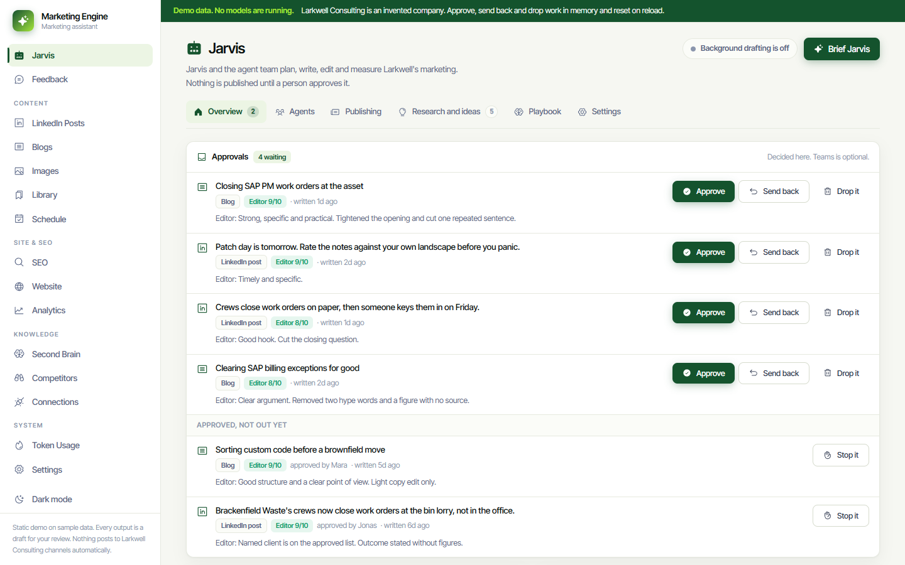
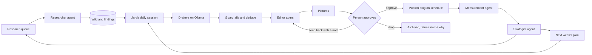

# Marketing Engine

A local-first marketing engine for a B2B consultancy. It researches, plans and drafts
LinkedIn posts and blog articles, draws their pictures, checks every draft against content
rules written in code, has an Editor agent rewrite or reject each one, and then **waits for a
person to approve it**. Blogs that a person approves are published to the company website on
schedule. LinkedIn posts are never posted by the tool.

**[Live demo](https://tacitdev1.github.io/marketing-engine/)**: a static build on sample data.
All fifteen screens, no server, no models. Code: [github.com/TacitDev1/marketing-engine](https://github.com/TacitDev1/marketing-engine).

> **This is a sanitised template.** The real tool was built for a consultancy and runs on its
> own data. Everything here is invented: **Larkwell Consulting**, its clients (Brackenfield
> Waste, Osterby Utilities), its products, staff, competitors, wiki pages, drafts and numbers.
> The domains use the reserved `.example` suffix. Any resemblance to a real firm is accidental.



## What it does

| Screen | What it is for |
| --- | --- |
| **Jarvis** | The control room: the Approvals inbox, the agent team and their last runs, this week's plan, today's briefing, the playbook of learned rules. |
| **Library** | Every draft with its Editor score and status (draft, approved, posted, archived). Read, edit, approve. |
| **Schedule** | The publishing calendar: a LinkedIn post every N working days, a blog on one weekday. Jarvis lines up the best draft for each slot. |
| **Second Brain** | A Markdown wiki the engine maintains for itself, with a link graph. |
| **Competitors** | Profiles of rival firms and a board of gaps where the company can win. |
| **Images** | Branded cards drawn as SVG, stock photos, and a live animated ASCII poster studio. |
| LinkedIn Posts, Blogs | Drafting by hand: pick an angle or a keyword, generate, edit, save to the Library. |
| SEO, Website, Analytics | Keyword plan and Search Console quick wins, managing the sibling website repository with a live preview, GA4 and Search Console numbers. |
| Feedback, Connections, Token Usage, Settings | Notes from the leadership team, which data sources are connected, the local models' token use, model settings. |

## How it grew: v1 to v2

The agent team did not replace the first version. It was added on top, and both run in the
code today.

**v1, the local-model engine.** An Express "brain" talks to [Ollama](https://ollama.com) on
the company's own hardware, so drafts never leave it. Three background agents do the slow work:

- **The Worker** researches news, sifts it and drafts from what is worth drafting. It starts
  switched off after every restart and only drafts while a person has switched it on.
- **The Researcher** claims queued topics and files findings, keywords and competitor profiles.
- **The Librarian** keeps the wiki tidy: merges overlapping pages, links orphans.

Content rules are enforced in code (`server/guardrails.js`, `server/critic.js`), not left to
the prompt: no AI-sounding copy, no invented clients (only names in `knownClients` may appear),
no unsourced figures, no duplicates by meaning, no em dashes, at most two hashtags, and a link
allowlist that strips every URL outside the company site.

**v2, the agent team.** Claude Code agents, each limited to its own tools:

- The register is `server/agent-team.js`: each agent's job, skills, slash command, days and
  allowed tools. The runner, `scripts/agents-window.mjs`, asks the brain who is due and runs
  each with the Claude CLI (never with permission checks skipped).
- The **Researcher** and the **Editor** run every weekday, **SEO** on Tuesday, **Measurement**
  then the **Strategist** on Friday. Their protocols are in `.claude/commands/mkt-*.md`.
- The **Editor** rewrites or rejects each draft. Code then decides (`server/editor.js`) whether
  a blog is cleared: 8/10 or better from the Editor *and* no hard-check failure.
- The **Strategist** files next week's plan, which steers Jarvis's daily writing session.
- Five wiki pages are kept current from the agents' records (`server/wiki-bridge.js`).
- The server draws each LinkedIn post's pictures itself, through headless Chrome on a bare
  render page (`server/post-images.js`, `server/render.js`, `src/render/RenderJob.jsx`).

## The closed loop



## Approvals

By default a person approves **in the app**: Jarvis > Overview > Approvals lists every blog the
Editor cleared and every LinkedIn post it passed, with **Approve**, **Send back** (with a note;
the Editor reworks it once), **Drop it** (archived with the reason, which Jarvis learns from), and
**Stop it** for an approved piece that has not gone out yet.

Optional: **connect your own Teams.** `server/approvals.js` can also post each decision as a card
to a Teams chat through Power Automate workflows you create, collect the clicks, and apply them
with the same rules (only named approvers count, one reminder, expiry after a week). Set the
`MKT_APPROVAL_*` addresses in `.env` to switch it on. Nothing is sent without them.

## Running the real thing

Requirements: Node 22 or newer, [Ollama](https://ollama.com) with `qwen3.5:9b`, `gemma4:12b`
and `nomic-embed-text` (or any models you set on the Settings screen), and ffmpeg for animated
poster exports. The agent team needs the [Claude Code CLI](https://docs.claude.com/en/docs/claude-code)
signed in on the machine that runs it.

```bash
git clone https://github.com/TacitDev1/marketing-engine.git && cd marketing-engine
cp .env.example .env     # fill in what you have; blanks show as "not connected"
npm ci
npm run dev              # web on http://localhost:5180, brain API on :8787
```

The repository ships with the Larkwell sample data in `data/` and `wiki/`, so the app has
something to show on first start. To point it at your own company, edit
`src/lib/company.js` (name, site, services, clients you may name, products, voice) and
`.agents/product-marketing.md`, then clear `data/`. The site URL, link allowlist and website
repository path can also be set in `.env` (`MKT_SITE_URL`, `MKT_LINK_ALLOWLIST`,
`MKT_WEBSITE_REPO`).

Run one agent by hand:

```bash
node scripts/agents-window.mjs --once researcher
```

On a server, set `MKT_DEPLOYMENT=server`. Jarvis then works in one session a day inside
`JARVIS_WINDOW_START`-`JARVIS_WINDOW_END`, and the agents' runner can be started by a systemd
timer at the start of that window. Keep the app bound to loopback behind an HTTPS proxy.

### The marketing skills

The agents work from the MIT-licensed marketing skills by Corey Haines,
[coreyhaines31/marketingskills](https://github.com/coreyhaines31/marketingskills). They are not
included here. Copy the skills you want into `.claude/skills/` (the names each agent uses are in
`server/agent-team.js`). Every skill reads `.agents/product-marketing.md` first.

## Demo mode

```bash
npm run build:demo       # static build in dist-demo/, served from /marketing-engine/
npm run preview:demo
```

The demo build swaps the API for `src/demo/mock-api.js`, which answers from
`src/demo/snapshot.json`. That snapshot is recorded from the real server running on the sample
data: `npm run demo:data` seeds `data/` through the server's own store functions
(`scripts/demo-fixtures.mjs` holds the invented content), starts the server, and records the
responses the demo screens read. What the real tool reads from outside services (Google
Analytics, Search Console, the Ollama model list) is invented in `scripts/demo-fixtures-screens.mjs`,
and the Website screen's live preview shows a small stand-in page (`public/demo-site/`). Dates
move forward by whole weeks so the sample always looks recent. Approve, send back, drop, feedback
and status changes work in memory; "Generate" hands back one of the sample drafts and says so.
Set `DEMO_BASE` to serve it from another path.

## Tests and checks

```bash
npm test                 # agent team, agent work, publishing and approvals, schedule, session
npm run leak-scan        # names, hosts, addresses and keys that must never be public
```

## Honest limits

- **LinkedIn posts are never posted by the tool.** Approving one marks it ready; a person posts it.
- **Two agents are registered but not built:** Conversion, and Sales and competitors. They show
  as "planned" and never run until their commands exist.
- Blogs publish by committing to a sibling Astro website repository and pushing it, only on a
  server, only after a person approved them, and only blog content.
- The demo shows every screen, but nothing in it runs: no model writes, no site is built, no
  Google data is fetched. The numbers on Analytics and SEO are invented.
- Built with Claude Code, directed and shipped by me.

## Licence

MIT, see [LICENSE](LICENSE). The marketing skills referenced above are MIT-licensed by their
author and are not part of this repository. The fonts (Inter Tight, JetBrains Mono) are
self-hosted in `public/fonts/` under the SIL Open Font License; the licence texts are next to them.
